# Reaction: React Movies App

**Web App Development 2: Assignment One**

A movie discovery app built with React 19, Vite, Material UI and TanStack React Query, using data from [The Movie Database (TMDB)](https://www.themoviedb.org/) API. It extends the lab movie app with many new TMDB endpoints, actor pages, playlists, filtering, sorting, search, pagination, trailers and a dark/light theme.

- **Demo video:** Placeholder
- **GitHub repo:** https://github.com/thava-51/react-movie-app

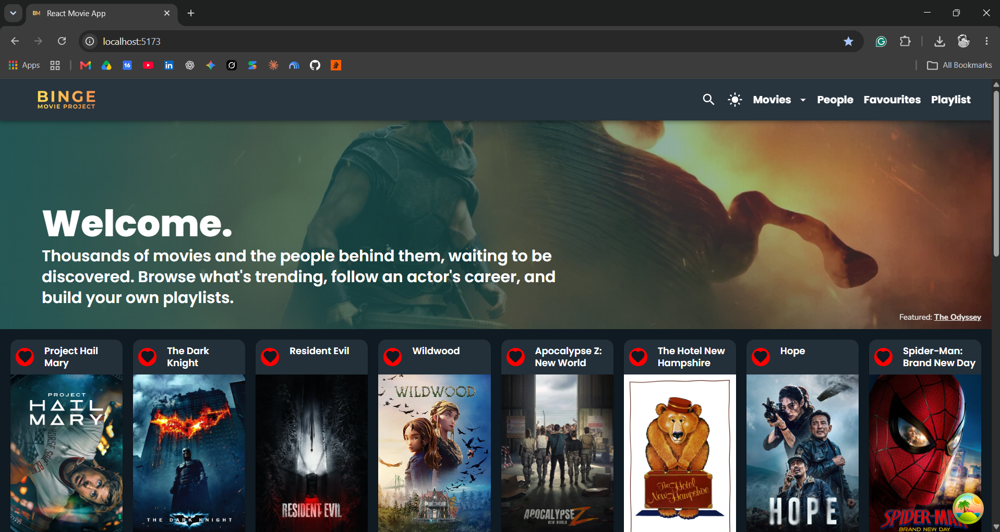

---

## Table of contents

1. [Features](#features)
2. [Pages and routes](#pages-and-routes)
3. [TMDB endpoints used](#tmdb-endpoints-used)
4. [Caching with React Query](#caching-with-react-query)
5. [Cross-linking](#cross-linking)
6. [Additional work](#additional-work)
7. [Installation and running](#installation-and-running)
8. [Project structure](#project-structure)
9. [Self-assessment against the rubric](#self-assessment-against-the-rubric)
10. [AI use declaration](#ai-use-declaration)

---

## Features

### Extending the app (new TMDB data)
- **Now Playing**, **Top Rated**, **Upcoming** and **Trending** (day/week toggle) pages.
- **Popular People** page.
- **Movie details** page with a cast row, recommendations row, similar-movies row, reviews and a trailer button.
- **Actor details** page with biography and full filmography.

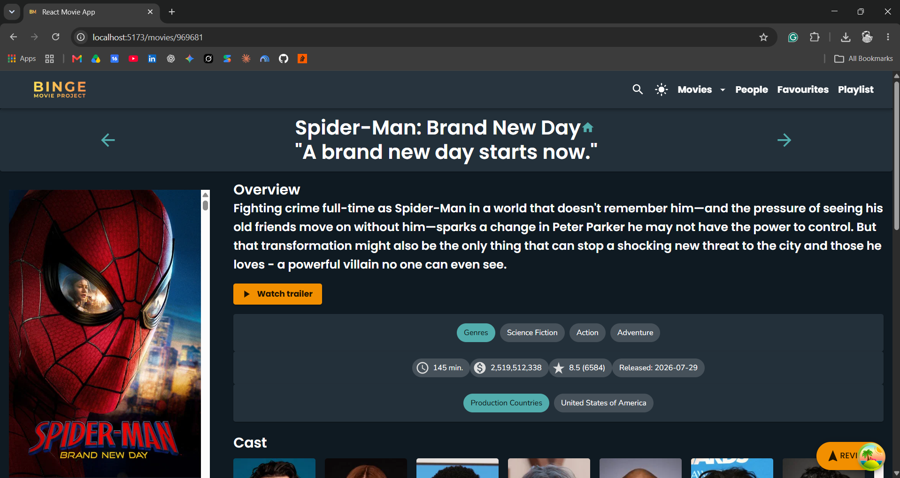
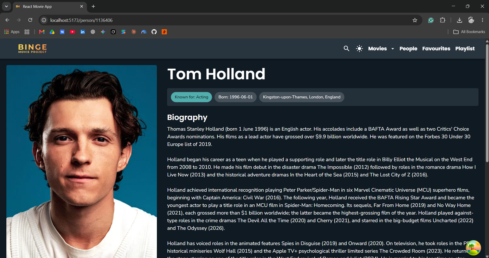


### Functionality
- **Playlists:** create several named playlists, add/remove movies from any movie card, view and switch between them on the Playlist page (tabs). Saved in `localStorage`, so they survive a refresh.
- **Favourites:** add/remove from any card, saved in `localStorage`.
- **Filtering:** by title, genre, release year, minimum rating and original language.
- **Sorting:** by popularity, rating, release date or title, ascending or descending.
- **Global search:** debounced search box in the header using `search/multi`, showing movies and people in separate sections with pagination.
- **Reviews:** read TMDB reviews and write your own review with a form (react-hook-form).

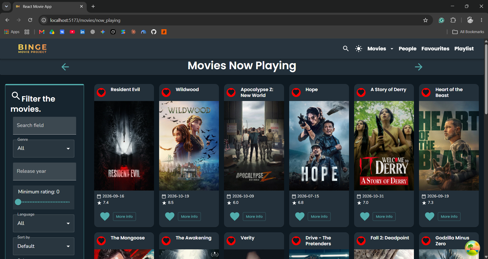
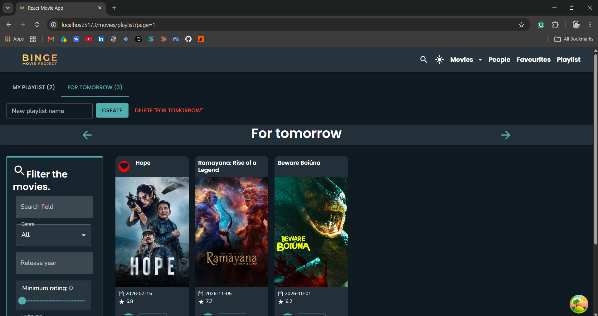
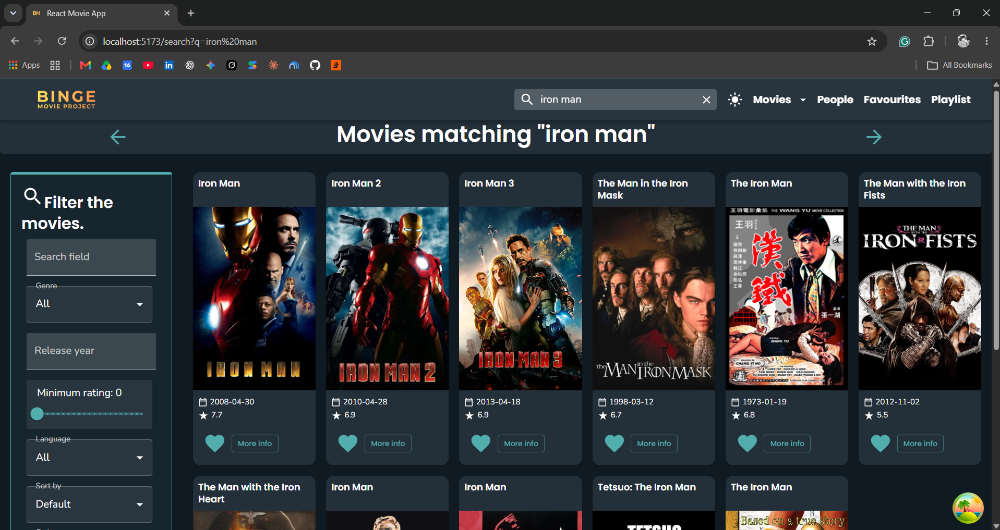

---

## Pages and routes

| Route | Page | Notes |
|---|---|---|
| `/` | Discover (home) | Hero banner, filters, sorting, pagination |
| `/movies/now_playing` | Now Playing | Paginated |
| `/movies/top_rated` | Top Rated | Paginated |
| `/movies/upcoming` | Upcoming | Paginated |
| `/movies/trending` | Trending | Day/week toggle, paginated |
| `/movies/:id` | Movie details | Cast, recommendations, similar, reviews, trailer |
| `/person/:id` | Actor details | Biography + filmography |
| `/people` | Popular people | Paginated |
| `/search?q=...` | Search results | Movies + people, paginated |
| `/movies/favorites` | Favourites | Stored in localStorage |
| `/movies/playlist` | Playlists | Multiple named playlists, stored in localStorage |
| `/reviews/:id` | Full review | |
| `/reviews/form` | Write a review | |

---

## TMDB endpoints used

All requests go through one helper, `tmdbFetch`, in [`movies/src/api/tmdb-api.jsx`](movies/src/api/tmdb-api.jsx).

### New static endpoints (no id in the path)

| Endpoint | Function | Used in |
|---|---|---|
| `/movie/now_playing` | `getNowPlaying` | Now Playing page |
| `/movie/top_rated` | `getTopRated` | Top Rated page |
| `/trending/movie/{day\|week}` | `getTrending` | Trending page, home hero banner |
| `/person/popular` | `getPopularPeople` | Popular People page |
| `/search/multi` | `searchMulti` | Search page |

### New parameterised endpoints (id in the path)

| Endpoint | Function | Used in |
|---|---|---|
| `/movie/{id}/credits` | `getMovieCredits` | Cast row on movie details |
| `/person/{id}` | `getPerson` | Actor details page |
| `/person/{id}/movie_credits` | `getMoviefromPerson` | Actor filmography |
| `/movie/{id}/recommendations` | `getRecommendations` | Recommendations row |
| `/movie/{id}/similar` | `getSimilar` | Similar movies row |
| `/movie/{id}/videos` | `getMovieVideos` | Trailer button/dialog |

### Endpoints from the labs (not counted as new)

`/discover/movie`, `/movie/upcoming`, `/movie/{id}`, `/movie/{id}/images`, `/movie/{id}/reviews`, `/genre/movie/list`

---

## Caching with React Query

Every TMDB call is made with `useQuery` (or `useQueries` for favourites/playlists), so responses are cached in the browser and shared between pages. Query keys include the parameters (for example `['now_playing', { page }]`, `['credits', { id }]`), so each page of results and each movie has its own cache entry. Default `staleTime` is set in [`main.jsx`](movies/src/main.jsx). `keepPreviousData` is used on paginated and search queries to avoid flicker when changing page.

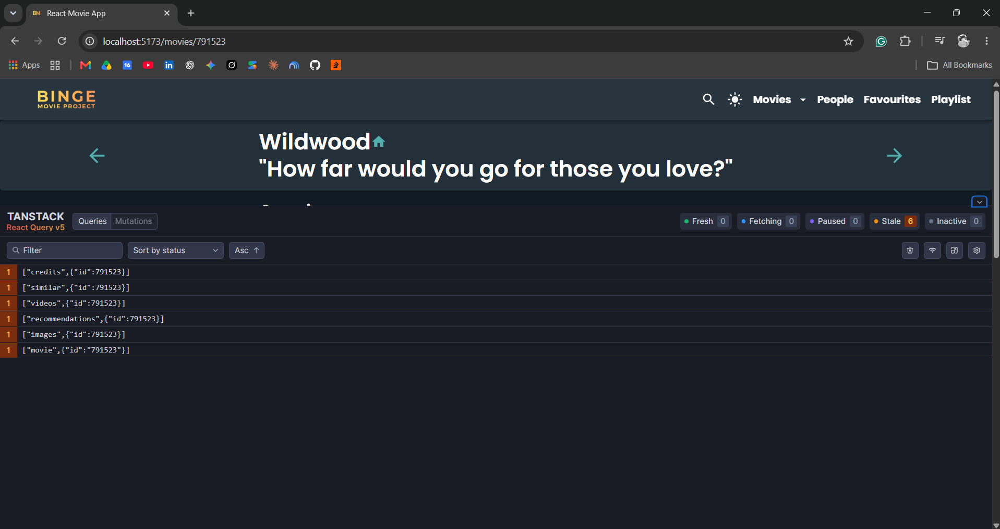

---

## Cross-linking

The app links data in a loop, so you can keep exploring:

**Movie > Cast member > Actor page > Filmography > Another movie > ...**

- Cast cards on a movie link to `/person/:id`.
- Filmography cards on an actor link back to `/movies/:id`.
- Recommendation and similar rows link to other movie pages.
- Popular People and search results link to actor pages.

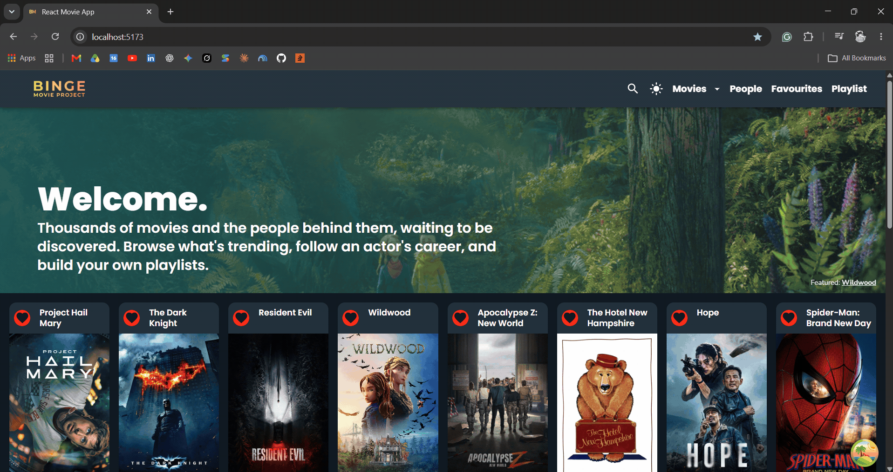

---

## Additional work

- Pagination (MUI `Pagination`) on every list page, using a `?page=N` URL parameter so pages are linkable.
- Trailer button that opens a MUI `Dialog` with an embedded YouTube video.
- Dark/light theme toggle with a custom MUI theme.
- Hero banner on the home page using trending movies.
- Header with a collapsing search bar and responsive menu.
- Custom logo, favicon and font; layout and styling overhaul.
- Debounced search input (custom `useDebounce` hook).
- Persistent state in `localStorage` through a reusable `usePersistentState` hook.

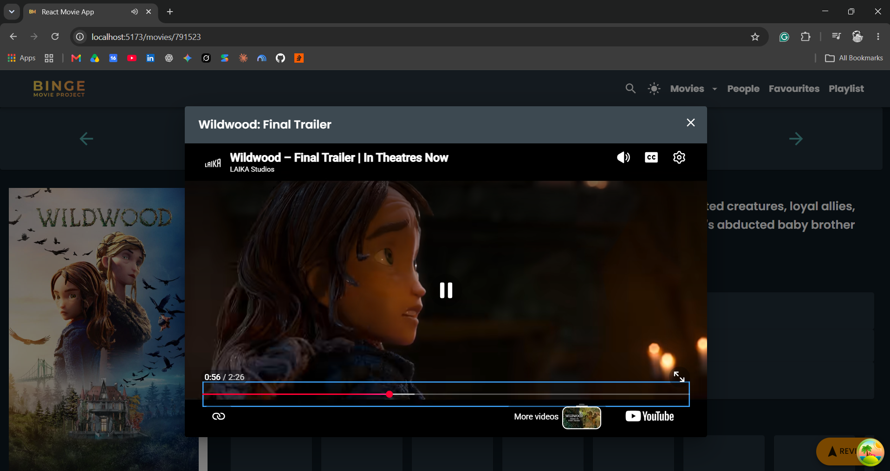
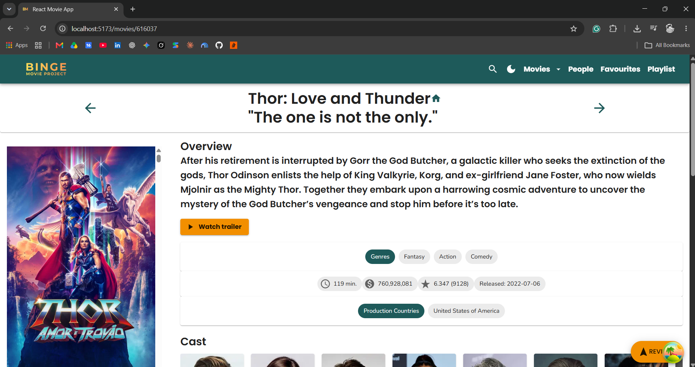
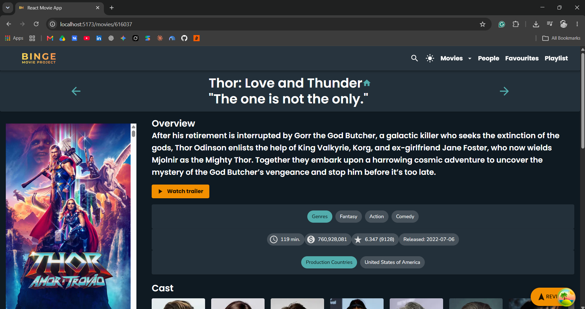
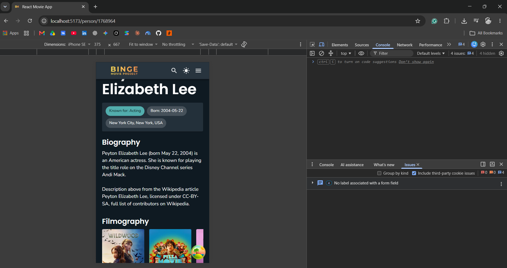

---

## Installation and running

**Requirements:** Node.js 20+ and a free [TMDB API key](https://developer.themoviedb.org/docs/getting-started).

```bash
git clone https://github.com/thava-51/react-movie-app
cd react-movie-app/movies
npm install
```

Create a file `movies/.env`:

```
VITE_TMDB_KEY=your_tmdb_api_key_here
```

Then run:

```bash
npm run dev       # start dev server (Vite)
npm run build     # production build
npm run lint      # ESLint
```

The `.env` file is git-ignored, so the API key is never committed.

---

## Project structure

```
movies/src/
  api/          tmdb-api.jsx        all TMDB calls
  components/   reusable UI (movieCard, movieRow, movieCast, filterMoviesCard, siteHeader, ...)
  contexts/     moviesContext.jsx   favourites, playlists, reviews
                colorModeContext.jsx theme mode
  hooks/        useDebounce, useMovie, ...
  pages/        one file per route
  theme.js      MUI theme
  main.jsx      router + providers
```

---

## Self-assessment against the rubric

Self Assessment has been presented in Excel form in Moodle.

### Known limitations

- Reviews you write are held in memory only and are lost on refresh.

---

## AI use declaration

AI assistance was limited to what the brief allows: troubleshooting errors, explaining code I did not fully understand, generating comments and help with code when necessary. All commits were made by me.